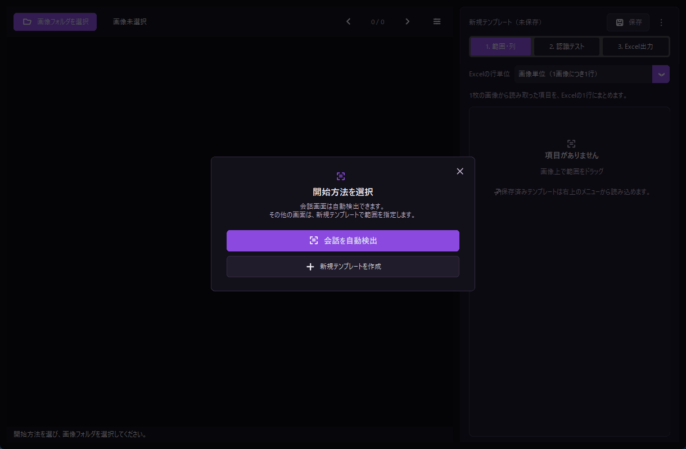
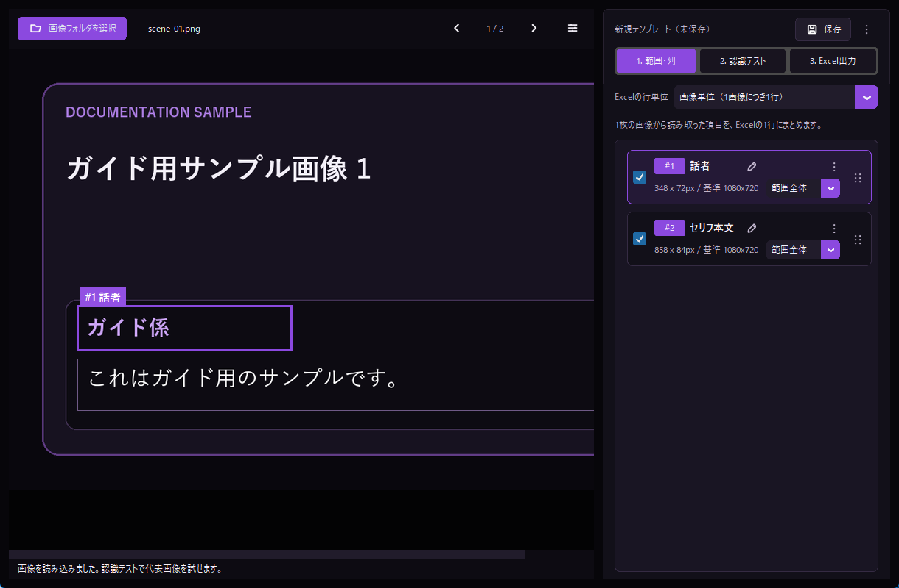
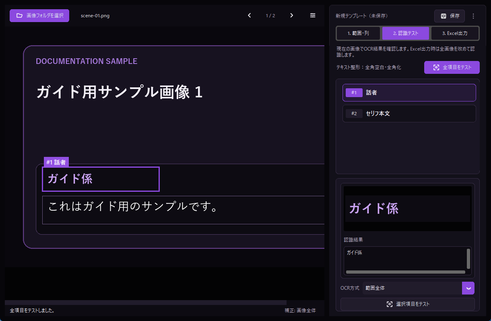
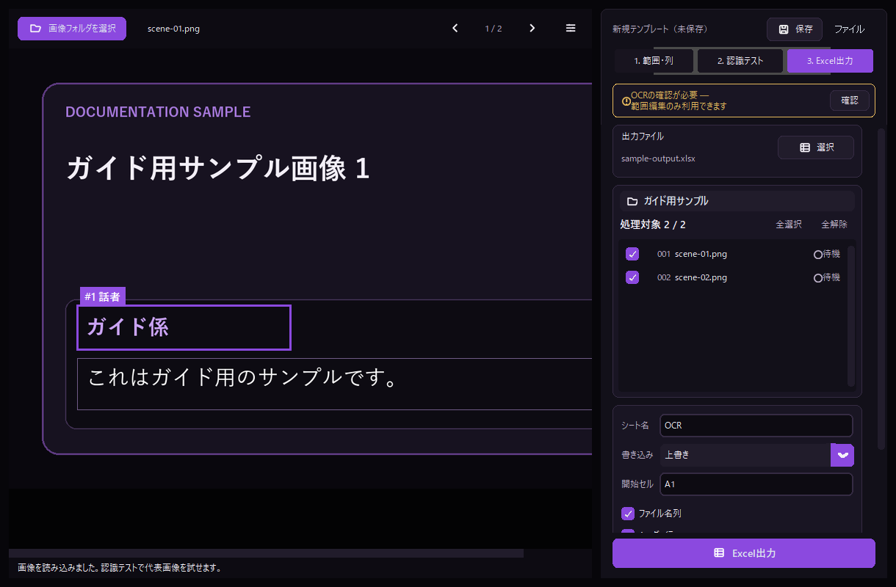
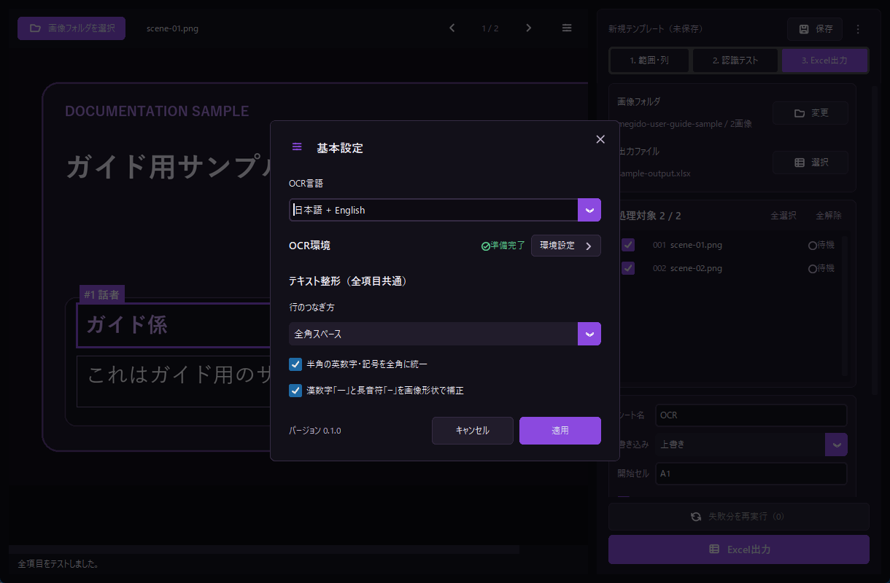

# Megido OCR to Excel ユーザーガイド

このガイドは、読み取り範囲の調整、認識結果の確認、Excel出力など、起動後の操作を目的別に説明します。

初回インストールと最初のExcelを作る手順は、[README](../README.md#はじめる)を参照してください。

## 作業を始める

起動時の **「開始方法を選択」** で、画像に合う開始方法を選びます。



- **「会話を自動検出」**

  メギド７２の会話画面、話者なし会話、ナレーション、会話ログを読み取るときに使います。画像ごとに話者とセリフの位置を検出し、**「セット単位（1セットにつき1行）」** で出力します。

- **「新規テンプレートを作成」**

  カード、見出し、特殊画面など、読み取りたい場所を自分で指定するときに使います。最初は **「画像単位（1画像につき1行）」** で始まります。

どちらを選んでも、続けてスクリーンショットのフォルダーを指定します。フォルダー内の `.png`、`.jpg`、`.jpeg`、`.bmp`、`.tif`、`.tiff` が自然順で読み込まれます。

保存済みテンプレートから始める場合は、右上の **「テンプレート操作」** メニューから **「テンプレートを読み込む」** を選びます。

## 1. 範囲・列

**「1. 範囲・列」** では、画像上の読み取り範囲とExcelへ出力する単位・順序を編集します。



### Excelの行単位を選ぶ

**「Excelの行単位」** で、1行にまとめる内容を選びます。

| 選択肢 | 向いている画像 | Excelでの結果 |
| --- | --- | --- |
| **「画像単位（1画像につき1行）」** | 1枚に1件分の情報がある画像 | 有効な項目を1行にまとめる |
| **「セット単位（1セットにつき1行）」** | 1枚に複数の会話や見出しがある画像 | セットごとに別の行へ出力する |

セット単位では、**「項目の組み合わせ」** から **「話者＋セリフ」** または **「見出し＋本文」** を選びます。各セットには、選んだ組み合わせの範囲が1つずつ必要です。

**「会話を自動検出」** から画像単位へ切り替えると、現在の画像で検出した位置が固定範囲として引き継がれ、以後は画像ごとの自動検出を行いません。

### 読み取り範囲を編集する

画像プレビュー上で操作します。

- 何もない場所をドラッグすると、読み取り範囲を追加します。
- 範囲の内側またはラベルをドラッグすると、範囲を移動します。
- 範囲の辺や角をドラッグすると、大きさを変更します。
- 範囲またはラベルをダブルクリックすると、項目名を編集します。
- 範囲を右クリックすると、編集、複製、削除などの操作を選べます。
- マウスホイールで上下にスクロールします。`Ctrl` を押しながら回すと、表示を拡大・縮小します。

直前の追加、削除、移動、サイズ変更は、`Esc` または `Ctrl+Z` で取り消せます。

### 項目と列順を整える

右側の項目一覧で、Excelへ出力する項目を整えます。

- チェックを外すと、その項目を認識・出力しません。
- 鉛筆ボタンまたは項目名のダブルクリックで、項目名を変更します。
- **「OCR方式」** で **「範囲全体」** または **「行切り出し」** を選びます。
- 右端のドラッグハンドルを上下に動かすと、Excelの列順を変更します。
- セット単位では、ドラッグハンドルで別のセットへ移動できます。**「未割当」** に残った項目があると出力できません。

**「行切り出し」** は、複数行の本文を行ごとに検出してから読み取ります。話者名や1行の値には **「範囲全体」**、複数行のセリフや本文には **「行切り出し」** が目安です。

### セットを追加・並べ替える

セット単位では、**「セットを追加」** を選び、表示される案内に従って必要な範囲を画像上で順番にドラッグします。

各 **「セット」** の上下ボタンでExcelへの出力順を変更できます。項目の種類が正しくない場合は、項目行のメニューで **「話者」**、**「セリフ」**、**「見出し」**、**「本文」** などを割り当て直します。

### テンプレートを保存・再利用する

読み取り範囲、列順、OCR方式、Excel設定、基本設定は、JSONテンプレートとして保存できます。

- **「保存」** または `Ctrl+S`: 現在のテンプレートを保存
- **「テンプレート操作」** → **「名前を付けて保存」** または `Ctrl+Shift+S`: 別名で保存
- **「テンプレート操作」** → **「テンプレートを読み込む」** または `Ctrl+O`: 保存済みテンプレートを読み込む

未保存の変更がある状態で別のテンプレートを読み込む、またはアプリを終了すると、保存するか確認されます。

## 2. 認識テスト

**「2. 認識テスト」** では、現在表示している1枚を使って、Excel出力前に認識結果を確認します。



1. **「全項目をテスト」** を選びます。
2. 項目一覧から確認したい項目を選びます。
3. 範囲プレビューと **「認識結果」** を確認します。

1項目だけ試す場合は、項目を選んで **「選択項目をテスト」** を使用します。範囲を変えた場合や **「OCR方式」** を切り替えた場合は、もう一度テストしてください。

上部の左右ボタン、または `Ctrl+←` / `Ctrl+→` で代表画像を切り替えられます。表示形式や文字量が異なる画像を数枚確認すると、範囲のずれや空結果を見つけやすくなります。

認識結果が合わない場合は、次を順に確認します。

1. **「1. 範囲・列」** に戻り、文字全体が範囲内に入っているか確認します。
2. 複数行の本文なら、**「OCR方式」** を **「行切り出し」** にします。
3. 上部の設定ボタンから **「基本設定」** を開き、OCR言語とテキスト整形を確認します。

## 3. Excel出力

**「3. Excel出力」** では、処理する画像、保存先、シートへの書き込み方法を指定します。



### 出力対象と保存先を決める

1. **「画像フォルダ」** を確認します。変更する場合は **「変更」** を選びます。
2. **「出力ファイル」** の **「選択」** から `.xlsx` の保存先を指定します。
3. **「処理対象」** で、不要な画像のチェックを外します。**「全選択」** と **「全解除」** も使用できます。

ファイル名を選ぶと、その画像がプレビューに表示されます。

### Excelへの書き込み方を決める

- **「シート名」**: 読み取り結果を書き込むシート
- **「書き込み」**: **「上書き」** または **「追記」**
- **「開始セル」**: 書き込みを始める左上のセル（例: `A1`）
- **「ファイル名列」**: 元画像のファイル名を列に含める
- **「ヘッダー行」**: 項目名の行を含める

既存ファイルを **「上書き」** するときは、実行前に確認画面が表示されます。処理を途中でキャンセルした場合、出力ファイルは変更されません。

### 出力結果を確認する

設定を確認して **「Excel出力」** を選びます。保存後は結果一覧に切り替わります。要確認画像があれば、先頭の画像と理由が表示されます。**「完了」** で成功した画像を確認でき、**「ブックを開く」** で保存したExcelを開けます。CSVで保存する場合は **「ファイル」→「CSV形式で保存…」** を選びます。

出力したExcelには、必要に応じて次のシートが追加されます。

- `Errors`: 画像を開けなかった、OCRに失敗した、認識結果が空だった項目
- `Notices`: 会話ログの端にある不完全な組み合わせなど、安全のため出力から除外した内容

### 要確認の画像に対処する

画像を選ぶと理由と操作が並びます。自動検出の対象外なら **「この画像でテンプレート作成」** で範囲を指定し、その画像だけを別のブックに出力できます。不要な画像は **「対象から除外」** で次回の処理対象から外せます。OCRエラーなどで **「この画像を再実行」** が表示される場合は、原因を解消した後に選ぶと元のブックを更新します。

再実行するまでは、出力ファイル、シート名、開始セル、Excelの行単位、出力列を変更しないでください。これらを変更した場合は、全画像を **「Excel出力」** し直します。

## 基本設定

画面上部の設定ボタンから **「基本設定」** を開きます。



### OCR言語

画像内の文字に合わせて選びます。

- **「日本語 + English」**
- **「日本語のみ」**
- **「English のみ」**

### テキスト整形

**「行のつなぎ方」** では、複数行の認識結果を **「スペースなし」**、**「全角スペース」**、**「改行」** のどれで結合するか選びます。

必要に応じて、次の補正も切り替えられます。

- **「半角の英数字・記号を全角に統一」**
- **「漢数字『一』と長音符『ー』を画像形状で補正」**

設定を変えたら **「適用」** を選び、代表画像で認識テストをやり直してください。

### OCR環境

**「OCR環境」** の **「環境設定」** では、認識モデルの状態、保存先、診断ログを確認できます。

- **「再確認」**: 保存済みモデルが現在の環境で使えるか確認する
- **「変更」**: モデル保存先を変更する
- **「自動設定に戻す」**: アプリの既定の保存先へ戻す
- **「フォルダーを開く」**: 診断ログの保存先を開く

モデル保存先を変更した場合は、案内に従ってアプリを再起動します。

## 主なショートカット

| キー | 操作 |
| --- | --- |
| `Ctrl+S` | テンプレートを保存 |
| `Ctrl+Shift+S` | テンプレートに名前を付けて保存 |
| `Ctrl+O` | テンプレートを読み込む |
| `Ctrl+Enter` | Excel出力 |
| `Ctrl+←` / `Ctrl+→` | 前後の画像へ移動 |
| `Alt+↑` / `Alt+↓` | 選択項目を並べ替える |
| `F2` | 選択項目の名前を変更 |
| `Esc` / `Ctrl+Z` | 直前の編集を取り消す |

確認画面や設定画面が開いているときの `Esc` は、その画面の戻る操作または閉じる操作になります。

## 困ったとき

### 画像フォルダーを選んでも画像が表示されない

選んだフォルダーの直下に、対応形式の画像があるか確認します。対応形式は `.png`、`.jpg`、`.jpeg`、`.bmp`、`.tif`、`.tiff` です。

### OCRを実行できない

右側に表示される状態に合わせて操作します。

- **「OCR未準備」**: **「準備」** → **「ダウンロードして準備」**
- **「OCRの確認が必要」**: **「確認」** → **「確認して更新」**
- **「OCR保存先に問題」**: **「保存先」** から有効なフォルダーを指定
- **「OCR実行環境が不足」**: **「修復」** からアプリを終了し、ランチャーで修復

### アプリが起動しない

展開先でPowerShellを開き、次を実行します。

```powershell
.\run_app.ps1 --repair
```

`uv` が見つからない場合は、[uvをインストール](https://docs.astral.sh/uv/getting-started/installation/)し、PowerShellを開き直します。

### 認識結果が空になる、または文字がずれる

代表画像を表示し、**「1. 範囲・列」** で範囲を確認してから、**「2. 認識テスト」** をやり直します。会話の自動検出で **「会話を自動検出できませんでした」** と表示された画像は、検出範囲を特に確認してください。

### 失敗分を再実行できない

前回の出力後に、出力先、シート名、開始セル、Excelの行単位、出力列を変更していないか確認します。変更している場合は、全画像を **「Excel出力」** し直します。

### 診断ログを確認したい

**「基本設定」** → **「OCR環境」** の **「環境設定」** → **「診断ログ」** → **「フォルダーを開く」** を選びます。
